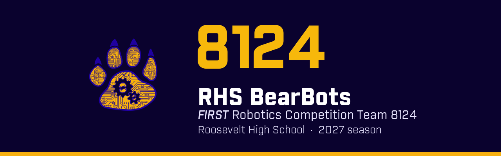

# FRC 8124 robot code · 2027

Robot code for the **RHS BearBots**, *FIRST* Robotics Competition Team 8124 at Roosevelt High School, for the 2027 season. Part of [Wyandotte Robotics](https://github.com/Wyandotte-Robotics).

> **Waiting for kickoff.** The 2027 game is revealed at kickoff in January. Until then, use the steps below to get set up and practice. The robot project goes in this repo at kickoff.

## Your first day

1. **Install the [WPILib tools](https://docs.wpilib.org/en/stable/docs/zero-to-robot/step-2/wpilib-setup.html).** The installer includes VS Code, Java and everything else you need. Use the current release (2026) for practice now. We'll switch to the 2027 release for kickoff.
2. **Install [GitHub Desktop](https://desktop.github.com/)** (or plain `git` if you already know it).
3. **Clone this repo** so you can practice making branches and pull requests.
4. **Work through [Zero to Robot](https://docs.wpilib.org/en/stable/docs/zero-to-robot/introduction.html)** and the [command-based programming guide](https://docs.wpilib.org/en/stable/docs/software/commandbased/index.html). That's how our robot code will be organized.

## At kickoff

A programming lead or mentor will:

1. Install the **2027 WPILib release** on every team laptop. 2027 is a big update, so don't mix 2026 and 2027 projects.
2. In VS Code, run **WPILib: Create a new project**: Java, **Command Robot** template, team number **8124**, saved into this repo's folder. ([How to](https://docs.wpilib.org/en/stable/docs/software/vscode-overview/creating-robot-program.html))
3. Add the vendor libraries for the motors and sensors we choose (**WPILib: Manage Vendor Libraries**).
4. Commit the new project to `main`, then everyone else works on branches.

Once the project is in, the build check below starts running on every pull request.

## Libraries teams commonly use

Decide after kickoff, once we know the robot design:

| Library | What it's for |
| --- | --- |
| [REVLib](https://docs.wpilib.org/en/stable/docs/software/vscode-overview/3rd-party-libraries.html) / Phoenix 6 | Motor controllers from REV or CTRE |
| [PathPlanner](https://pathplanner.dev) | Drawing and following autonomous paths |
| [AdvantageKit](https://docs.advantagekit.org) | Logging everything the robot does, so you can replay matches |
| [PhotonVision](https://docs.photonvision.org) | Camera-based targeting and AprilTags |

## How we work

Read the [contributing guide](https://github.com/Wyandotte-Robotics/.github/blob/main/CONTRIBUTING.md) before your first change. The short version:

- Make a branch, open a pull request, get a review. Never commit straight to `main`.
- Test before you ask for a review, and say how you tested.
- Only code from `main` goes on the robot at competitions.
- No passwords, student last names, contact details or photos. This repo is public.

## Links

- [The Blue Alliance: Team 8124](https://www.thebluealliance.com/team/8124)
- [WPILib documentation](https://docs.wpilib.org)
- [Chief Delphi](https://www.chiefdelphi.com) (the FRC community forum)
- [Wyandotte Robotics](https://wyandotterobotics.com)
